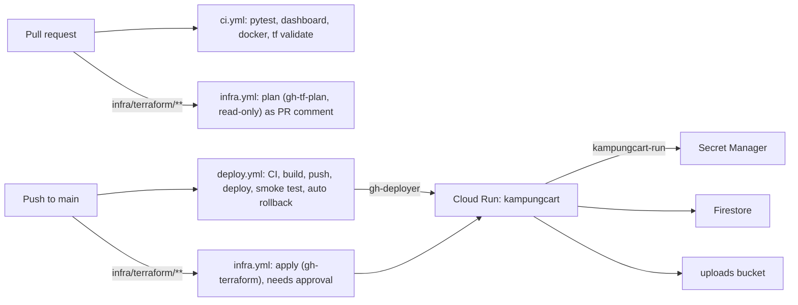

# KampungCart infrastructure

Everything on Google Cloud is defined in Terraform and shipped by GitHub Actions.

| What | Where | Who changes it |
|---|---|---|
| State bucket, base APIs | [`bootstrap/`](bootstrap/main.tf) | By hand, once per project |
| APIs, IAM, WIF, registry, secrets (containers), Cloud Run config, Firestore, uploads bucket, monitoring, budget | [`terraform/`](terraform/) | PR → plan comment → merge → `infra.yml` applies after approval |
| The running image (which revision serves) | Artifact Registry + Cloud Run | `deploy.yml` on every push to `main` |
| Secret **values** | Secret Manager | By hand, `gcloud secrets versions add` (never in Terraform state) |

- **Project:** `kampungcart-prod` (number `42629827376`), region `asia-southeast1`
- **Service URL:** `https://kampungcart-42629827376.asia-southeast1.run.app`
- **State:** `gs://kampungcart-prod-tfstate` (versioned), prefixes `bootstrap/` and `main/`



## Identities (no service-account keys anywhere)

GitHub Actions authenticates with **Workload Identity Federation**. The OIDC provider only accepts
tokens from `Aisha1124/works-on-cloud`.

| Service account | Used by | Can |
|---|---|---|
| `kampungcart-run` | Cloud Run at runtime | read the 2 secrets, Firestore, the uploads bucket, write logs/metrics |
| `gh-deployer` | `deploy.yml`, **main branch only** | push images, create revisions, shift traffic |
| `gh-tf-plan` | `infra.yml` on PRs (any branch) | metadata only: custom `tfPlanReader` role + narrow viewer roles, read state. **No** Firestore documents, bucket objects or secret values |
| `gh-terraform` | `infra.yml` apply, **`production` environment only** | admin on what Terraform manages |

Also hardened:
- The default compute SA (`PROJECT_NUMBER-compute@`) has its project-wide Editor removed
  (`google_project_iam_member_remove` in `iam.tf`). Nothing runs as it.
- All GitHub Actions are pinned to a commit SHA; Dependabot (`.github/dependabot.yml`) proposes
  updates weekly for actions, Terraform providers and Docker base images.
- `generativelanguage.googleapis.com` (Gemini API-key API) is disabled; Gemini goes through Vertex AI.
- `.dockerignore` excludes `gha-creds-*.json`, the short-lived file that `google-github-actions/auth` writes.

## Image

| Stage | Base | What it does |
|---|---|---|
| `dashboard` | `node:24-slim` | `npm ci` + `npm run build` -> `dashboard/dist` |
| `python-deps` | `python:3.12-slim` + uv | `uv sync --frozen --no-dev` from `uv.lock` -> `/app/.venv` |
| `runtime` | `python:3.12-slim` | venv + `agents/` + `backend/` + `dashboard/dist`, non-root, `uvicorn` on `$PORT` |

CI tags images with the git SHA and deploys **by digest**. Registry cleanup keeps the 10 newest.

Local run: `docker build -t kampungcart:local . && docker run --rm -p 8080:8080 --env-file .env -e BASE_URL=http://localhost:8080 kampungcart:local`

## Day-to-day

**Ship app code:** merge to `main`. `deploy.yml` runs CI, deploys, smoke-tests (`/api/health`,
UCP profile URL, owner routes return 401, MCP lists its tools, the "Order with AI" chat route
answers an unknown chat with 410 (no Gemini call), dashboard 200) and rolls back automatically on
failure.

**Change infrastructure:** edit `infra/terraform/*.tf` in a PR, read the plan comment, merge,
approve the `production` environment run.

**Rotate a secret:**
```bash
printf '%s' 'NEW_VALUE' | gcloud secrets versions add owner-key --data-file=- --project kampungcart-prod
# Pick it up with a new revision (re-run the Deploy workflow, or):
gcloud run services update kampungcart --region asia-southeast1 --project kampungcart-prod \
  --update-labels=secret-rotated=$(date +%s)
```

**Read the owner key** of the sample shop `mak-kuih`: `gcloud secrets versions access latest --secret owner-key --project kampungcart-prod`
(every other shop gets its own key when it goes live).

**Turn on email** (Gmail SMTP with an app password):
```bash
printf '%s' 'you@gmail.com'    | gcloud secrets versions add smtp-user     --data-file=- --project kampungcart-prod
read -s "P?App password: " && printf '%s' "$P" | gcloud secrets versions add smtp-password --data-file=- --project kampungcart-prod && unset P
```
Then set `smtp_enabled = true` (tfvars locally, or `TF_VAR_smtp_enabled` in `infra.yml`) and apply.

**Roll back by hand:**
```bash
gcloud run revisions list --service kampungcart --region asia-southeast1 --project kampungcart-prod
gcloud run services update-traffic kampungcart --region asia-southeast1 --project kampungcart-prod \
  --to-revisions=REVISION=100
```
Terraform ignores `traffic` and the image, so a later `terraform apply` won't undo a rollback.

**Logs:** `gcloud run services logs read kampungcart --region asia-southeast1 --project kampungcart-prod --limit 100`

## Running Terraform locally

```bash
gcloud config configurations activate kampungcart     # bijaypathak55@gmail.com / kampungcart-prod
cd infra/terraform
cp terraform.tfvars.example terraform.tfvars          # billing account + alert email (gitignored)
export GOOGLE_OAUTH_ACCESS_TOKEN=$(gcloud auth print-access-token)   # or: gcloud auth application-default login
terraform init
terraform plan
```

Prefer PRs over local applies, so state changes go through review.

## Rebuilding from scratch (new project)

1. Create the project, link billing, then `cd infra/bootstrap`. Comment out the `backend "gcs"`
   block, `terraform init && terraform apply`, restore the block, then `terraform init -migrate-state`.
2. `cd infra/terraform`. Set `project_id` and the state bucket in `versions.tf`, then apply
   everything **except** `google_cloud_run_v2_service.app`,
   `google_cloud_run_v2_service_iam_member.public` and the uptime/alert resources (use `-target`).
3. Add the secret value for `owner-key` (and later `smtp-user` / `smtp-password`) with `gcloud secrets versions add`.
4. Push a first image: `docker buildx build --platform linux/amd64 -t REGION-docker.pkg.dev/PROJECT/kampungcart/app:initial --push .`
5. `terraform apply` (everything).
6. Set the GitHub variables below and create the `production` environment.

## GitHub setup (repo admin)

**Settings → Secrets and variables → Actions → Variables** (values from `terraform output`):

| Variable | Value |
|---|---|
| `GCP_PROJECT_ID` | `kampungcart-prod` |
| `GCP_REGION` | `asia-southeast1` |
| `WIF_PROVIDER` | `terraform output -raw wif_provider` |
| `DEPLOYER_SA` | `terraform output -raw deployer_service_account` |
| `TF_PLAN_SA` | `terraform output -raw tf_plan_service_account` |
| `TERRAFORM_SA` | `terraform output -raw terraform_service_account` |
| `TF_BILLING_ACCOUNT` | billing account id |
| `TF_ALERT_EMAIL` | alert email |

**Settings → Environments → New environment `production`:** add a required reviewer and limit
deployment branches to `main`. The `gh-terraform` account only trusts jobs in this environment.

## Known limits

- **Data** lives in Firestore (`(default)`, asia-southeast1, point-in-time recovery 7 days,
  delete protection) and menu photos in `kampungcart-prod-uploads`, so deploys and restarts
  keep everything. Rate limits, sessions and idempotency keys are in Firestore too, so up to
  `max_instances` (10) instances can run side by side.
- **Gemini** runs through Vertex AI as `kampungcart-run` (no API key). `GEMINI_LOCATION=global`
  means Gemini requests may be served outside Singapore.
- **Rate-limit key** = rightmost `X-Forwarded-For` entry (added by Cloud Run). If a load balancer
  is ever put in front, `backend/external.py:client_key` must change.
- **"Order with AI" chat** (Google ADK) keeps each conversation in the instance's memory, so the
  service runs with **session affinity** (`session_affinity` in `run.tf`, `--session-affinity`
  in `deploy.yml`). If an instance goes away mid-chat, the customer starts a new chat; orders are
  in Firestore and never lost. It uses Vertex AI like the menu reader: no extra secret or role.
- **`min_instances = 1`** keeps the 5-minute background jobs (order expiry, 90-day erase) running
  and avoids cold starts. It costs an always-on instance; see the budget alert.
- [`scripts/deploy.py`](../scripts/deploy.py) is a break-glass manual deploy only. Normal deploys
  go through CI. [`DEPLOY.md`](DEPLOY.md) is the manual Cloud Shell path; this Terraform setup
  replaces it for `kampungcart-prod`.
