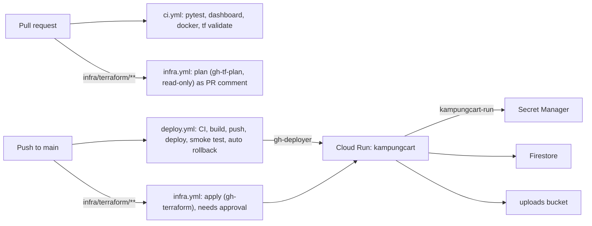

# KampungCart infrastructure

Everything on Google Cloud is defined in Terraform and shipped by GitHub Actions.

| What | Where | Who changes it |
|---|---|---|
| State bucket, base APIs | [`bootstrap/`](bootstrap/main.tf) | By hand, once per project |
| APIs, IAM, WIF, registry, secrets (containers), Cloud Run config, Firestore, uploads bucket, monitoring, budget | [`terraform/`](terraform/) | PR → plan comment → merge → `infra.yml` applies after approval |
| The running image (which revision serves) | Artifact Registry + Cloud Run | `deploy.yml` on every push to `main` |
| Secret **values** | Secret Manager | By hand, `gcloud secrets versions add` (never in Terraform state) |

- **Project:** `kampungcart-prod` (number `42629827376`), region `asia-southeast1`
- **Service URL:** `https://kampungcart-42629827376.asia-southeast1.run.app`
- **State:** `gs://kampungcart-prod-tfstate` (versioned), prefixes `bootstrap/` and `main/`



## Identities (no service-account keys anywhere)

GitHub Actions authenticates with **Workload Identity Federation**. The OIDC provider only accepts
tokens from `Aisha1124/works-on-cloud`.

| Service account | Used by | Can |
|---|---|---|
| `kampungcart-run` | Cloud Run at runtime | read the 2 secrets, Firestore, the uploads bucket, write logs/metrics |
| `gh-deployer` | `deploy.yml`, **main branch only** | push images, create revisions, shift traffic |
| `gh-tf-plan` | `infra.yml` on PRs | read-only (viewer, security reviewer), state lock |
| `gh-terraform` | `infra.yml` apply, **`production` environment only** | admin on what Terraform manages |

## Image

| Stage | Base | What it does |
|---|---|---|
| `dashboard` | `node:22-slim` | `npm ci` + `npm run build` -> `dashboard/dist` |
| `python-deps` | `python:3.12-slim` + uv | `uv sync --frozen --no-dev` from `uv.lock` -> `/app/.venv` |
| `runtime` | `python:3.12-slim` | venv + `agents/` + `backend/` + `dashboard/dist`, non-root, `uvicorn` on `$PORT` |

CI tags images with the git SHA and deploys **by digest**. Registry cleanup keeps the 10 newest.

Local run: `docker build -t kampungcart:local . && docker run --rm -p 8080:8080 --env-file .env -e BASE_URL=http://localhost:8080 kampungcart:local`

## Day-to-day

**Ship app code:** merge to `main`. `deploy.yml` runs CI, deploys, smoke-tests (`/api/health`,
UCP profile URL, owner routes return 401, dashboard 200) and rolls back automatically on failure.

**Change infrastructure:** edit `infra/terraform/*.tf` in a PR, read the plan comment, merge,
approve the `production` environment run.

**Rotate a secret:**
```bash
printf '%s' 'NEW_VALUE' | gcloud secrets versions add owner-key --data-file=- --project kampungcart-prod
# Pick it up with a new revision (re-run the Deploy workflow, or):
gcloud run services update kampungcart --region asia-southeast1 --project kampungcart-prod \
  --update-labels=secret-rotated=$(date +%s)
```

**Read the owner key** (for the dashboard): `gcloud secrets versions access latest --secret owner-key --project kampungcart-prod`

**Roll back by hand:**
```bash
gcloud run revisions list --service kampungcart --region asia-southeast1 --project kampungcart-prod
gcloud run services update-traffic kampungcart --region asia-southeast1 --project kampungcart-prod \
  --to-revisions=REVISION=100
```
Terraform ignores `traffic` and the image, so a later `terraform apply` won't undo a rollback.

**Logs:** `gcloud run services logs read kampungcart --region asia-southeast1 --project kampungcart-prod --limit 100`

## Running Terraform locally

```bash
gcloud config configurations activate kampungcart     # bijaypathak55@gmail.com / kampungcart-prod
cd infra/terraform
cp terraform.tfvars.example terraform.tfvars          # billing account + alert email (gitignored)
export GOOGLE_OAUTH_ACCESS_TOKEN=$(gcloud auth print-access-token)   # or: gcloud auth application-default login
terraform init
terraform plan
```

Prefer PRs over local applies, so state changes go through review.

## Rebuilding from scratch (new project)

1. Create the project, link billing, then `cd infra/bootstrap`. Comment out the `backend "gcs"`
   block, `terraform init && terraform apply`, restore the block, then `terraform init -migrate-state`.
2. `cd infra/terraform`. Set `project_id` and the state bucket in `versions.tf`, then apply
   everything **except** `google_cloud_run_v2_service.app`,
   `google_cloud_run_v2_service_iam_member.public` and the uptime/alert resources (use `-target`).
3. Add the secret values (`gemini-api-key`, `owner-key`) with `gcloud secrets versions add`.
4. Push a first image: `docker buildx build --platform linux/amd64 -t REGION-docker.pkg.dev/PROJECT/kampungcart/app:initial --push .`
5. `terraform apply` (everything).
6. Set the GitHub variables below and create the `production` environment.

## GitHub setup (repo admin)

**Settings → Secrets and variables → Actions → Variables** (values from `terraform output`):

| Variable | Value |
|---|---|
| `GCP_PROJECT_ID` | `kampungcart-prod` |
| `GCP_REGION` | `asia-southeast1` |
| `WIF_PROVIDER` | `terraform output -raw wif_provider` |
| `DEPLOYER_SA` | `terraform output -raw deployer_service_account` |
| `TF_PLAN_SA` | `terraform output -raw tf_plan_service_account` |
| `TERRAFORM_SA` | `terraform output -raw terraform_service_account` |
| `TF_BILLING_ACCOUNT` | billing account id |
| `TF_ALERT_EMAIL` | alert email |

**Settings → Environments → New environment `production`:** add a required reviewer and limit
deployment branches to `main`. The `gh-terraform` account only trusts jobs in this environment.

## Known limits

> **Data is not persistent yet.** Until `FirestoreStore` / `GcsImageStore` are implemented the
> service runs with `store_backend = "local"`: shops, orders, audit log and photos live on the
> instance's in-memory disk and are **lost on every deploy or restart**. Firestore and the uploads
> bucket already exist. When the app supports them, set `store_backend = "firestore"` and raise
> `max_instances`.

- One instance (`min = max = 1`) while data is local. The order rate limiter is in memory, too.
- Rate-limit key = rightmost `X-Forwarded-For` entry (added by Cloud Run). If a load balancer is
  ever put in front, `backend/external.py:client_key` must change.
- Single shared `OWNER_KEY` for all shops.
- Gemini via API key (in Secret Manager). Restrict the key to the Generative Language API.
- [`scripts/deploy.py`](../scripts/deploy.py) is a break-glass manual deploy only. Normal deploys go through CI.
